# How Banhall works

The one map of the web app: what the parts are, how they connect, and where to look when something changes or breaks. Start at section 1 and read down; each section zooms in on one box from the section before.

Last checked against the code at commit `fc016a6f` on branch `feat/clients-and-projects-redesign`, 2026-10-21. When a change moves a box or an arrow, update this file in the same change (see section 12).

Deeper references, when you need them: `docs/product-domain.md` (the binding rules for workflow and permissions), `docs/system-map.md` (the 2026-09-03 audit, with risks and open questions), `docs/the-brain.md`, `docs/design-system.md`.

**Colour key used in every diagram**

| Colour | Means |
| --- | --- |
| Yellow | People |
| Blue | The web app in the browser (`src/`) |
| Green | The Convex backend (`convex/`) |
| Purple | AI services outside our code |
| Grey | Other outside tools and services |
| Red | A person must act before anything moves on |
| Dashed | Exists on paper but blocked or not built yet |

---

## 1. The big picture

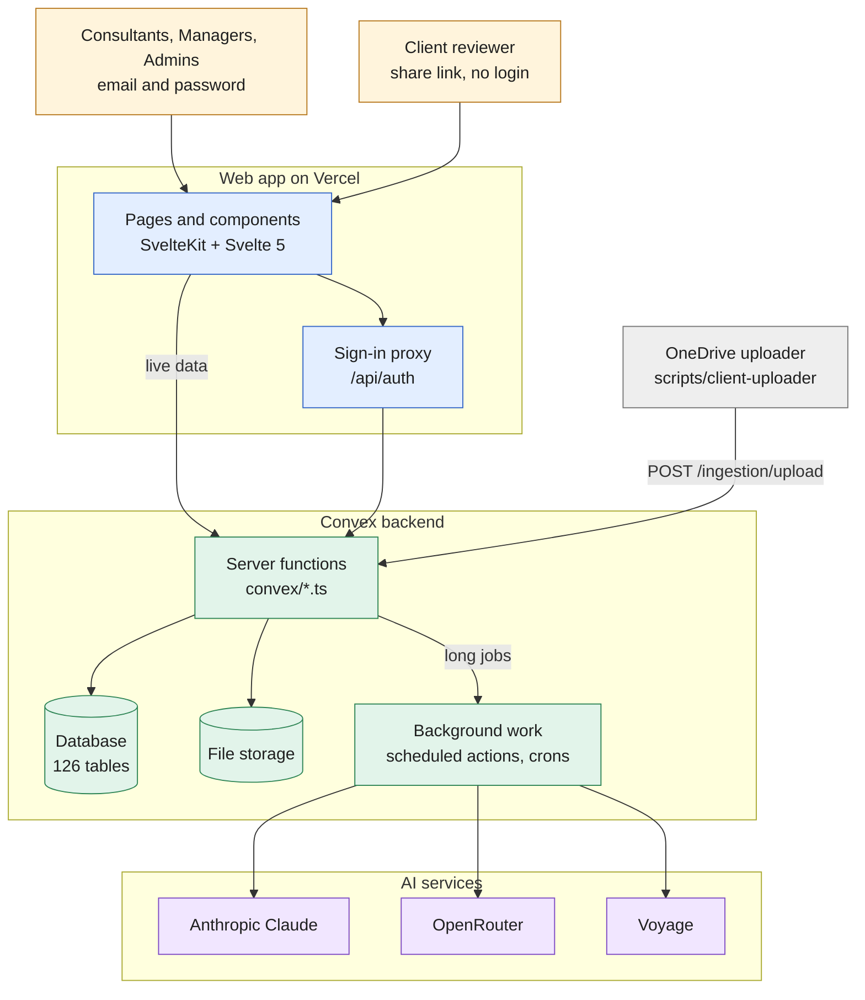

Claude drafts, chats and checks. OpenRouter carries the GPT and Gemini models, web search, and a fallback route to Claude. Voyage powers Brain search.

Five facts explain most of the app:

1. **The browser keeps no data of its own.** Every screen subscribes to Convex queries. When a row changes, every open screen that reads it updates on its own, with no refresh.
2. **Convex enforces every rule.** Hiding a button in the browser is only a convenience. Each query and mutation checks the signed-in person's role again on the server.
3. **The AI never writes report text by itself.** It proposes a change; a person clicks Apply. This is the most important rule in the product.
4. **Long jobs run in the background.** Drafting, chat replies, QA and research run as Convex actions. The browser watches their progress rows and shows them live.
5. **There is one Convex deployment today** (`energized-salamander-237`). Developers and writers use the same one; there is no separate production backend yet.

---

## 2. The life of a project

This is the path a piece of work takes from start to finish. Every later section explains one or more of these steps.

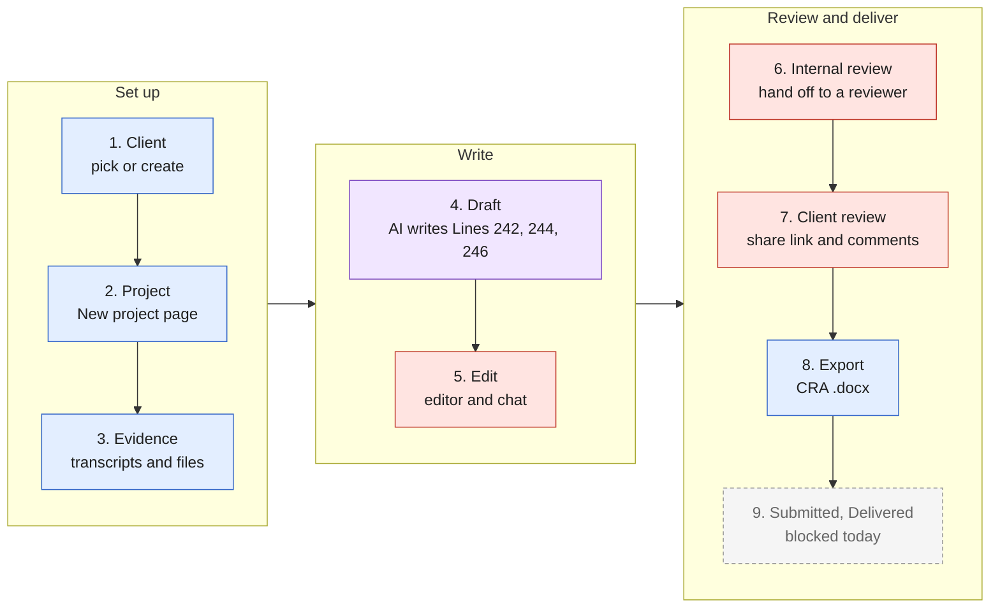

| Step | Where it happens (page) | Backend module | Main tables |
| --- | --- | --- | --- |
| 1. Client | `/projects` client list, client picker on New project | `convex/clients.ts` | `clients` |
| 2. Project | `/project/new` | `convex/projects.ts`, `convex/intakeDrafts.ts` | `projects`, `intakeDrafts` |
| 3. Evidence | `/project/new`, Files panel on `/project/[id]` | `convex/transcripts.ts`, `convex/documents.ts` | `transcripts`, `projectDocuments` |
| 4. Draft | `/project/[id]` | `convex/generations.ts`, `convex/ai/` | `generations`, `generationSources`, `reports` |
| 5. Edit | `/project/[id]` editor and chat panel | `convex/reports.ts`, `convex/chatV2.ts` | `reports`, `chatProposals`, `reportSnapshots` |
| 6. Internal review | Details panel on `/project/[id]`, Home (`/my-work`) | `convex/workItems.ts`, `convex/projectWorkflow.ts` | `workItems`, `reviewDecisions`, `projectEvents` |
| 7. Client review | `/review/[shareToken]` | `convex/comments.ts`, `convex/projects.ts` (`publishForReview`) | `comments`, `commenters`, `reportViews` |
| 8. Export | Export button on `/project/[id]` | `convex/reports.ts` (preflight, authorize, complete) and `src/lib/exportTemplateDocx.ts` | `reportExports` |
| 9. Submitted, Delivered | Details panel (shown disabled) | `convex/projectWorkflow.ts` refuses both | `reportBranches` and `productionOutcomes` do not exist yet |

---

## 3. The data: what is stored and how it connects

There are 126 tables in `convex/schema.ts`. Most are supporting detail. These are the ones that carry the story:

Read each arrow as "has many". The second line in each box says what the rows are for.

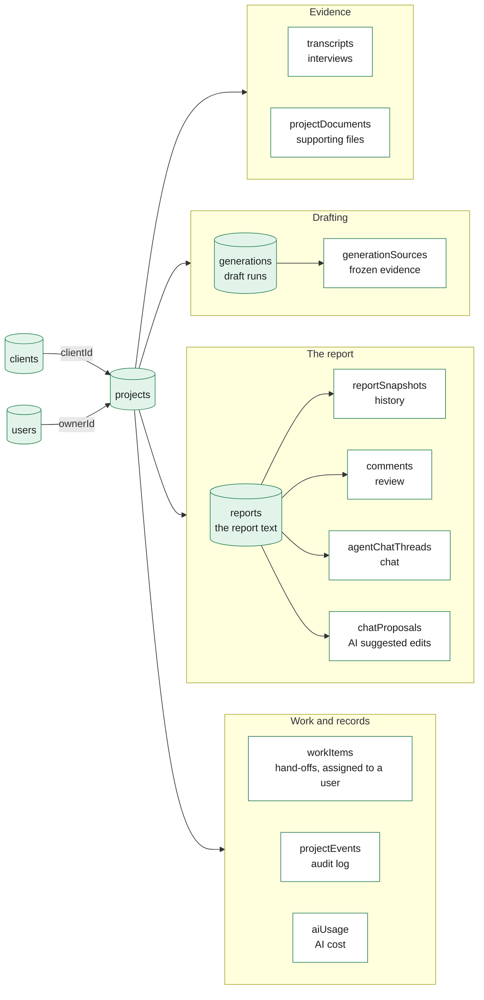

Users also have `notifications` (their inbox) and the `workItems` assigned to them.

**The report itself** is one row in `reports`, which also records the run that produced it (`reports.generationId`). Its `content` field is the Tiptap editor document stored as a JSON string, with three headings, "Line 242", "Line 244" and "Line 246", that both the backend and the editor rely on (`src/lib/reportSections.ts`). Every save bumps `revisionNumber` and `contentHash`. An editor save names the revision it started from and is refused if the report has moved on; export checks both, so the file matches the text that was reviewed.

**A project has four separate state fields.** They look alike but answer different questions, and the product rules forbid one writing into another:

| Field on `projects` | Answers | Who changes it |
| --- | --- | --- |
| `workflowStage` | Where is the work? (Intake, Drafting, Internal review...) | People, through `projectWorkflow.setWorkflowStage` and `workItems.handOff` |
| `activeGenerationId` pointing to `generations.status` | What is the AI doing right now? | The drafting engine only |
| `generationActivity` | Same as above, copied for dashboard badges | The drafting engine only |
| `status` | Old field (draft, generating, review, client_review, final) | Kept for compatibility; do not build on it |

**Clients are new (2026-10-14).** Projects now store both `clientName` and `clientId`, and every write keeps the two in step. Grouping on the Projects page still reads `clientName`; nothing groups by `clientId` yet.

**Tables by area**

| Area | Count | Examples |
| --- | --- | --- |
| People and access | 5 | `users`, `invites`, `userActivity` |
| Clients and projects | 8 | `clients`, `projects`, `projectEvents`, `dashboardCompanies`, `tags` |
| Evidence (inputs) | 19 | `transcripts` and their turns, speakers, facts and digests; `projectDocuments`; `intakeDrafts`; financial uploads |
| Report and editing | 9 | `reports`, `reportSnapshots`, `comments`, `reportExports`, `reportProvenance` |
| Drafting engine | 32 | `generations`, `generationSources`, `generationSectionRuns`, `generationBriefs`, `briefPreparations`, `seeds`, `reportCandidates`, `complianceNotes` |
| Chat and research | 13 | `agentChatThreads`, `chatTurns`, `chatProposals`, `researchSessions` |
| Review and QA | 7 | `qaFindings`, `reviewDecisions`, `writerReviews`, `pdReviews`, `comparisons` |
| Brain and learning | 13 | `brainSources`, `learningDigests`, `writerProfiles`, `ingestionItems` |
| Work and notifications | 8 | `workItems`, `workItemEvents`, `workItemOversight`, `notifications` |
| AI usage and models | 8 | `aiUsage`, `modelCatalog`, `modelRoleAssignments` |
| Admin and misc | 4 | `appSettings`, `errorReports`, `changelogEntries` |

Convex components keep their own tables outside this count: `betterAuth` (sign-in accounts), `agent` (chat messages), `rag` (Brain vectors), `rateLimiter`, `embedPool` (a work queue for Brain embedding) and `researchWorkflow`.

---

## 4. Inside the browser

### Pages

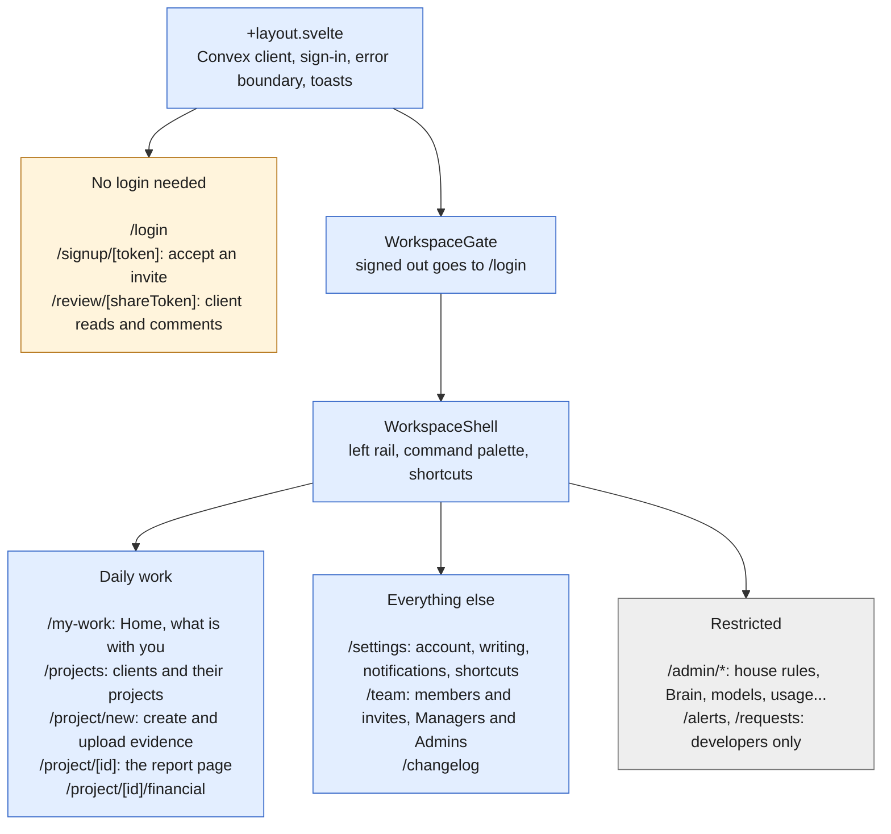

- `/` sends you to `/my-work` when signed in, otherwise to `/login`.
- `/dashboard` is the old entry. It redirects to the new pages, or shows the old interface when the URL has `?workspace=current`. The old interface stays in the repo as a rollback.
- There is no `/clients` page. Clients live on `/projects`; `?client=<key>` selects one, and the rail's Companies link points there.
- Admin pages: house-rules, tags, brain, ingestion, models, reviews, learning and usage are on the rail; comparisons, backfill and users open from the command palette.

### How a page gets and changes data

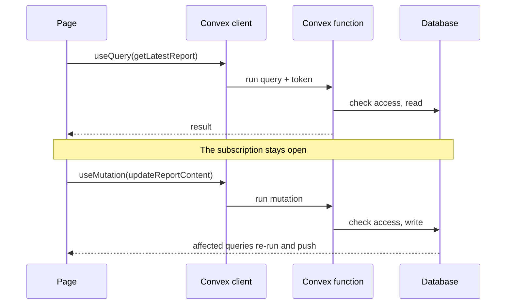

The page asks for data with `useQuery` and keeps listening. When anyone writes with a mutation, every query that read the changed rows runs again and pushes the new result to every open page.

### How sign-in works

1. `/login` calls Better Auth in the browser (`src/lib/authClient.ts`).
2. The request goes to our own site at `/api/auth/*`, which forwards it to Convex (`src/lib/server/authProxy.ts`).
3. Convex Better Auth (`convex/auth.ts`) checks the password and sets a cookie holding a 15-minute token.
4. `src/hooks.server.ts` reads that cookie for the first page load and adds security headers. After that, the Convex client sends the token with every query.
5. New people join only by invite. A Manager or Admin creates the invite on `/team` and copies the link by hand; there is no email service.

### Uploading files

Text is pulled out in the browser before anything is sent: PDFs with pdf.js, Word files with mammoth (`src/lib/parseDocument.ts`), spreadsheets in a Web Worker (`src/lib/spreadsheet.worker.ts`), transcripts in `src/lib/transcriptUpload.ts`. The original file is uploaded separately: `documents.generateUploadUrl`, then a direct POST to Convex storage, then `claimUpload` (`src/lib/uploads/originalUpload.ts`).

---

## 5. The report page

`/project/[id]` is where most of the work happens. The page component is `src/lib/components/project/PreviewProjectPage.svelte`. Each panel talks to its own backend module:

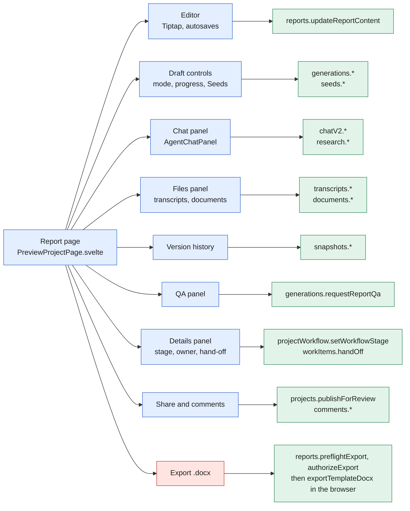

- Chat, version history, QA and the step-by-step stepper load only when opened, so the page starts fast.
- Export builds the file in the browser by filling `static/templates/schedule60.docx` with JSZip. Before that, the server checks the report revision, the Line 206 science code and filing readiness. `exportTemplateDocx` must only be imported in browser-only code.
- CRA limits that the drafting engine and export both enforce: 78 characters per line; Line 242 up to 50 lines or 350 words, Line 244 up to 100 lines or 700 words, Line 246 up to 50 lines or 350 words (`convex/lib/lineLimits.ts`).

---

## 6. Writing a draft

The writer picks one of three modes (`shared/generationModes.ts`):

| Mode | Label in the app | What happens |
| --- | --- | --- |
| `iterative` | Step by step (recommended) | AI suggests ideas (Seeds) per subsection; the writer picks and signs off; then AI writes |
| `single` | Single draft | One full draft goes straight to the editor |
| `compare` | Compare two drafts | Two models each write a draft; the writer keeps the better one |

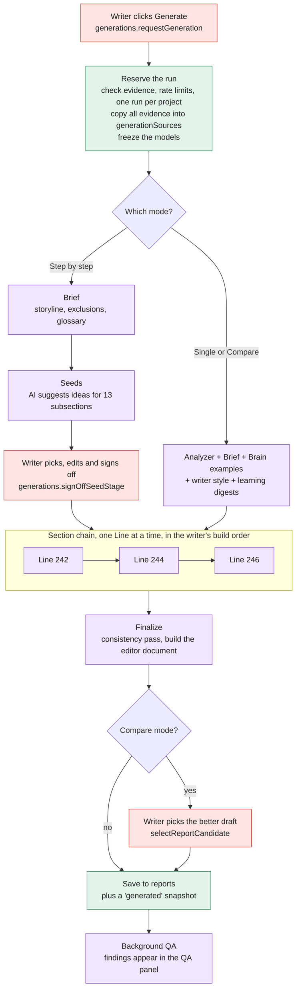

**Inside each Line** (`convex/ai/orderedGeneration.ts`): draft, then remove banned words, then shorten to the CRA limits, then a self-check (fixed rules plus one AI check), then at most one repair. Each Line reads the Lines already written. Notes on which style rules were applied go to `complianceNotes`.

**Run status** on the `generations` row (`shared/generationTransitions.ts`):

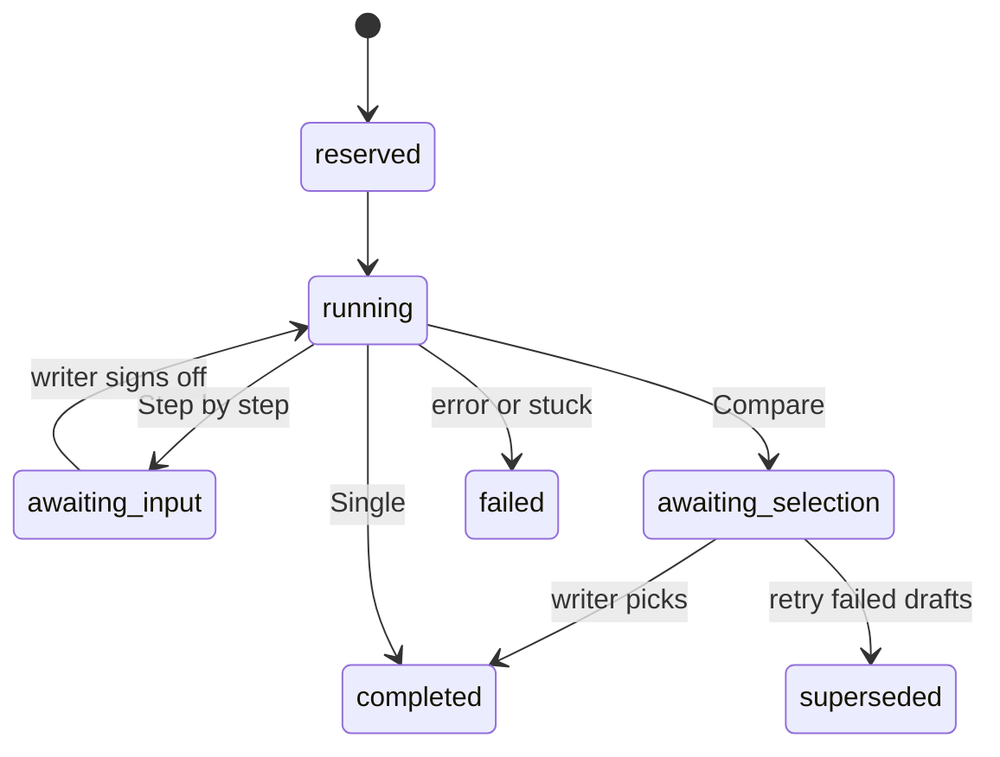

`awaiting_input` means Step by step is waiting for the writer to sign off the Seeds. `awaiting_selection` means Compare is waiting for the writer to pick a draft. Any active status can also end in `failed`.

A cron checks every 10 minutes and fails any run with no progress for 30 minutes (`convex/lib/generations/reapers.ts`), so a crash never leaves a project stuck on "Generating".

**Which AI model does what** (`shared/modelCatalog.ts`, `convex/lib/generationSteps.ts`): the writer's chosen model drafts, repairs and shortens; a "planning" model runs the analyzer, Brief and Seeds; a "checking" model runs self-check, consistency and QA. The default writing model is `claude-sonnet-5`. Admins change role assignments on `/admin/models`.

**Cost and limits.** Every AI call is recorded in `aiUsage` (see `/admin/usage`). Rate limits live in `convex/lib/aiRateLimits.ts`, for example 12 drafts per person per hour and 6 per project per hour.

---

## 7. Chat: the AI proposes, the writer applies

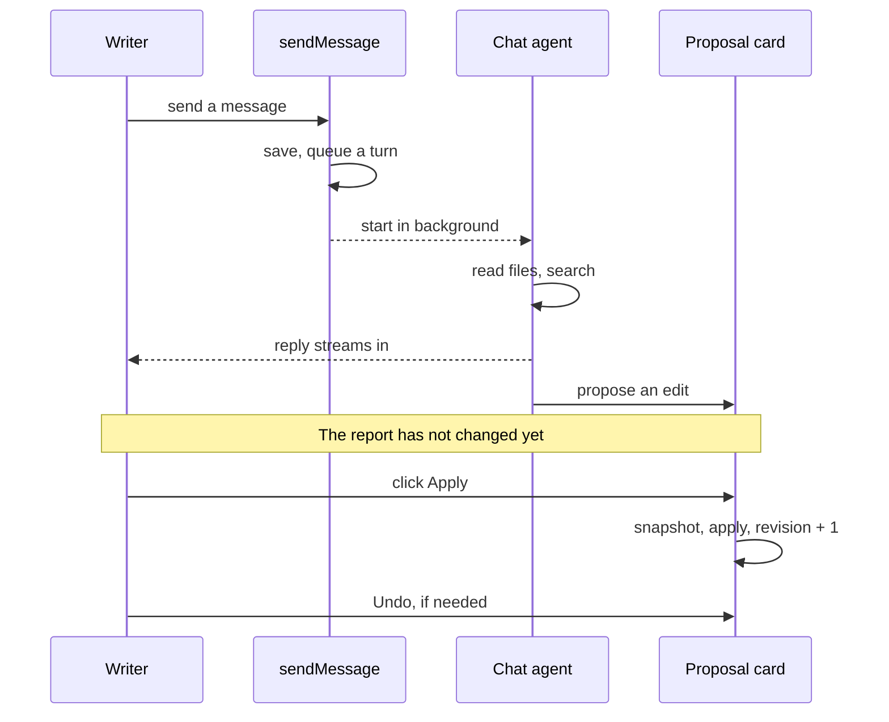

1. `chatV2.sendMessage` saves the message and queues a chat turn.
2. The chat agent (`convex/ai/chatAgentV2.ts`) runs in the background. It can read the project's files and search the web or the Brain, and its reply streams to the screen.
3. When it wants to change the report, it saves a proposal card as `pending`. The report is untouched.
4. The writer clicks Apply. `chatV2.applyProposal` checks access, snapshots the report, applies the change and bumps the revision.
5. Undo reverses an applied card, after taking another snapshot.

The chat agent has 12 tools. Only the first three can produce an edit, and each one only creates a card that waits for the writer:

| Tool | What it does |
| --- | --- |
| `proposeEdit` | Suggest replacing one passage |
| `proposeReplacements` | Suggest a find-and-replace across the report |
| `proposeBulkEdits` | Suggest a larger revision, with a report of what changed |
| `highlightPassages` | Point at passages, no edit |
| `deviationInventory` | List where paragraphs depart from the style rules |
| `compareReferencePd` | Compare with last year's report |
| `readDocument`, `searchDocuments`, `readTranscript` | Read the project's files and transcripts |
| `viewFile` | Look at PDF pages and images |
| `searchWeb` | Web search through OpenRouter, with names removed from the query |
| `searchBrain` | Search approved past reports, only when the writer turns it on |

Proposal card states: `pending`, then `applied`, `rejected` or `stale` (the target text was no longer in the report). Undo moves an applied card back to `pending`. A reply that crashes is failed by a cron that runs every 2 minutes.

**Research** (`convex/research.ts`, `convex/ai/research/`) works on a selected passage: web research, deep research and Brain patterns run side by side, a reviewer model merges them, and the result arrives as a proposal card like any other.

---

## 8. Where the AI's style and knowledge come from

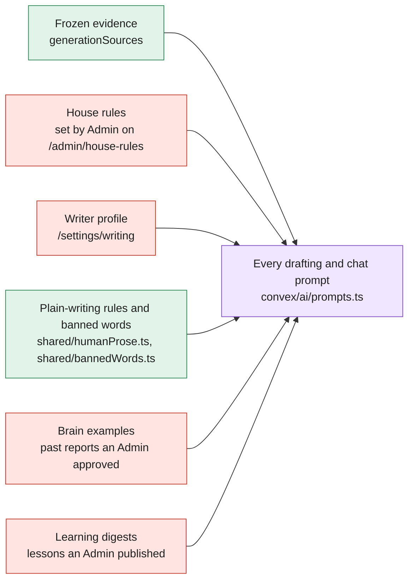

- **Plain-writing rules** in `shared/humanProse.ts` always apply and cannot be switched off. Change them there, not inside one prompt.
- **House rules** (`shared/houseRules.ts`) are the firm's rulebook. An Admin decides which ones writers may waive.
- **The Brain** is a library of good past reports. Material reaches it three ways, and every way needs an Admin:
  - a writer review scoring 85 or more nominates the report;
  - writer feedback an Admin approves is nominated too;
  - an Admin approves a file imported from OneDrive on `/admin/ingestion` (this one goes straight in).

  Nominations wait as pending until an Admin approves them on `/admin/brain`. Approved material is embedded with Voyage and searched during drafting.
- **Learning digests** are short lessons distilled from writer feedback, QA feedback and edits, refreshed nightly. A digest only reaches prompts after an Admin publishes it.
- **Provenance:** each run records which prompt version, digests and Brain sources it used (`generations.promptVersion`, `learningDigestIds`, `brainProvenance`).

---

## 9. Workflow, roles and hand-offs

### Stages

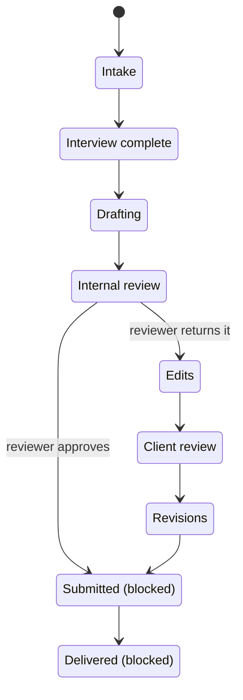

- Any stage can move to any other; the diagram shows the usual path. On hold and Abandoned can be reached from anywhere and need a note. Abandoning is refused while work items are open, and only a Manager or Admin can reopen an abandoned project.
- Moving from Internal review to Edits or to Submitted needs a recorded reviewer decision (return or approve), saved in `reviewDecisions` against the exact report revision.
- **Submitted and Delivered are refused for everyone today.** They need report branches and delivery outcomes, which are not built yet (`convex/projectWorkflow.ts`).
- Every stage change goes through one writer (`patchProjectWorkflowStage` in `convex/lib/dashboardProjection.ts`). In the same step it updates the dashboard counts and appends a `projectEvents` row, so the history is never lost.

### Owner and hand-offs

- `createdBy` is who made the project and never changes. `ownerId` is who is accountable and can be transferred. Permissions use the owner, never the creator.
- A **work item** is a request to one person: internal review, revision, interview follow-up, delivery prep, financial or other. It is open, then completed, declined or canceled, and never reopens.
- `projects.currentHandoffId` points to the one open blocking work item, which answers "who has it now". Home (`/my-work`) shows what is with you.
- Handing off (`workItems.handOff`) picks a person and a stage at once, cancels the previous hand-off and notifies the new person.

### Who can do what

Roles are stored on `users.role` (`shared/roles.ts`). "Own" means projects where you are the owner, or where you hold an open work item when editing the report. The full matrix is in `shared/capabilities.ts`.

| Can... | Consultant | Manager | Admin |
| --- | --- | --- | --- |
| Create projects, read all internal projects | Yes | Yes | Yes |
| Edit report text, change stage, transfer owner, create work items | Own | All | All |
| Complete someone else's work item | No | Yes | Yes |
| See financial data | No | Yes | Yes |
| See the team, send invites | No | Yes | Yes |
| Change roles, configure settings, see alerts | No | No | Yes |

Server-side checks live in `convex/lib/auth.ts` (`requireCurrentUser`, `requireInternalProjectAccess`) and `convex/lib/roleCapabilities.ts` (`requireCapability`, `requireReportEditAccess`). A client on a share link can read only the published report and add comments.

---

## 10. Background jobs, outside services and deployment

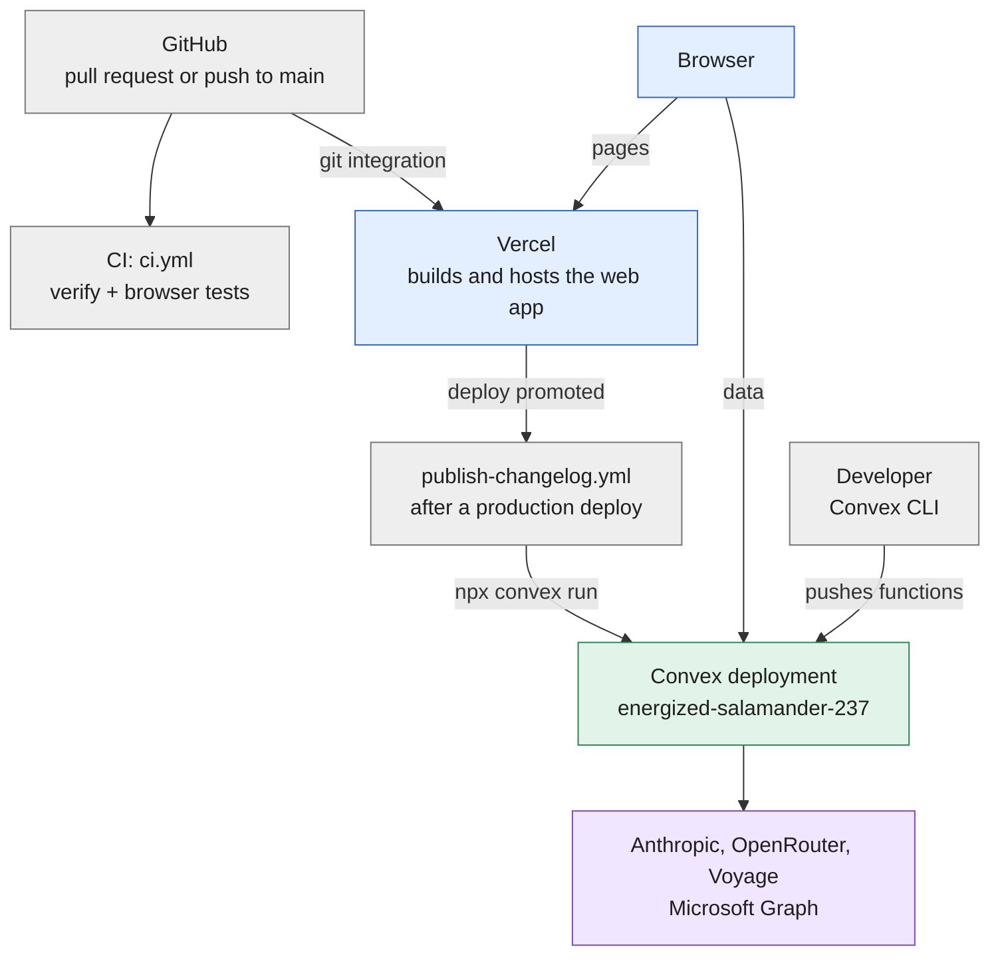

- The web app deploys through Vercel's git integration (`vercel.json`, adapter in `vite.config.ts`).
- Convex functions are not deployed by CI; nothing in the repo runs `convex deploy`. Backend changes reach the deployment when a developer pushes them with the Convex CLI.
- CI runs `bash scripts/loop-verify.sh` (preflight, Convex typecheck, `npm run check`, `npm test`, test-discovery guard, build, two uploader harnesses) and a separate browser component suite.

**Crons** (`convex/crons.ts`), grouped by purpose:

| Purpose | Jobs |
| --- | --- |
| Unstick crashed work | Draft runs (every 10 min, after 30 min idle), PD reviews and post-draft QA (every 10 min), chat replies (every 2 min), conversation deletes (every 5 min) |
| Clean up | Expire intake drafts (every 15 min), purge failed Brief preparations (hourly), release unreferenced files, prune error reports and notifications older than 30 days (daily) |
| Learn | Refresh the QA calibration and draft style digests (daily, 08:00 and 08:15 UTC) |
| Keep views correct | Rebuild the "waiting on others" view and My Work backfills (every 5 min) |
| Models | Refresh the model catalog from OpenRouter (daily, 08:45 UTC) |

**Outside services** and the environment variable names Convex reads (values are never in the repo):

| Service | Used for | Variables |
| --- | --- | --- |
| Anthropic | Drafting, chat, checks | `ANTHROPIC_API_KEY`, `ANTHROPIC_TRANSPORT` |
| OpenRouter | Other models, web search, fallback when Anthropic billing fails | `OPENROUTER_API_KEY`, `OPENROUTER_ANTHROPIC_API_KEY` |
| Voyage | Brain embeddings and reranking | `VOYAGE_API_KEY` |
| Microsoft Graph | OneDrive import | `MS_TENANT_ID`, `MS_CLIENT_ID`, `MS_CLIENT_SECRET`, `MS_DRIVE_ID`, `MS_ROOT_PATH` |
| Upload scripts | `POST /ingestion/upload` | `INGEST_API_KEY` |
| Sign-in | Better Auth | `SITE_URL`, `BETTER_AUTH_TRUSTED_ORIGINS`, `AUTH_PROXY_SECRET` |

---

## 11. Rules that never bend

If a change breaks one of these, stop and discuss it before merging.

1. **AI proposes, people apply.** No code path lets an AI tool change report text directly. Every AI edit goes through `chatProposals` and `applyProposal`.
2. **Every draft traces to exact inputs.** Evidence is copied into `generationSources` when a run starts, with the prompt version and models frozen.
3. **Workflow and AI state stay apart.** `workflowStage` is for people; `generations.status` is for the engine. Neither writes the other.
4. **`createdBy` is never reused.** Accountability is `ownerId`.
5. **Convex checks every permission.** The browser only hides what you cannot do.
6. **Stage changes and hand-offs leave a trail.** `projectEvents` and `workItemEvents` are append-only.
7. **Nothing enters the Brain or a published digest without an Admin.**
8. **Every AI call is metered** in `aiUsage`.
9. **Never hand-edit `convex/_generated/`.**
10. **New workflow stages, transitions or permissions need a recorded amendment** in `docs/product-domain.md` first.

### Known gaps today

These are real and expected, not bugs to chase:

- Submitted and Delivered cannot be reached (section 9).
- `clientId` is written but not yet used for grouping (section 3).
- Invites are copied by hand; there is no email service.
- One shared Convex deployment and no automated backend deploy (section 10).
- Research saves its proposal cards directly instead of through the chat's `saveProposal` check.
- Revoking a Brain source does not remove lessons already distilled into digests.
- Step by step runs are left out of the draft style digest.
- The old interface (`?workspace=current`) and the old Projects board components are still in the repo as a rollback; the board is not mounted anywhere.

---

## 12. Reviewing a change with this map

When a change comes in, ask four questions:

1. **Which box does it touch?** Use the table below.
2. **Does it add or remove an arrow?** A new route, table, background job, outside service, or a new call between boxes means this file needs an update in the same change.
3. **Does it bend a rule in section 11?** If yes, stop and discuss.
4. **Will a person notice it?** Add a changelog entry (`docs/changelog-guidelines.md`).

| If the change touches... | It is in this box | Read section |
| --- | --- | --- |
| `src/routes/`, `src/lib/components/`, `src/lib/shell/`, `src/lib/workspace/` | Web app | 4, 5 |
| `convex/schema.ts` | Data | 3 |
| `convex/projectWorkflow.ts`, `convex/workItems.ts`, `shared/workflow*.ts`, `shared/capabilities.ts` | Workflow and access | 9 |
| `convex/generations.ts`, `convex/lib/generations/`, `convex/ai/pipeline.ts`, `convex/ai/orderedGeneration.ts`, `convex/ai/iterative.ts`, `convex/seeds.ts`, `convex/briefs.ts` | Drafting engine | 6 |
| `convex/chatV2.ts`, `convex/ai/chatAgentV2.ts`, `convex/research.ts`, `src/lib/components/chat/` | Chat | 7 |
| `convex/brain.ts`, `convex/learning.ts`, `convex/ai/brain*`, `shared/houseRules.ts`, `shared/humanProse.ts`, `convex/ai/prompts.ts` | Style and knowledge | 8 |
| `convex/auth.ts`, `src/lib/server/`, `src/hooks.server.ts`, `convex/lib/auth.ts` | Sign-in and access | 4, 9 |
| `convex/crons.ts`, `convex/http.ts`, `vercel.json`, `.github/workflows/`, `scripts/` | Platform | 10 |

### Where to look when something breaks

| Symptom | First place to look |
| --- | --- |
| Draft stuck on "Generating" | The `generations` row status; the 10-minute cron fails it after 30 idle minutes (`convex/lib/generations/reapers.ts`) |
| Step by step stops after the Seeds | It is waiting for the writer to sign off (`awaiting_input`); see `convex/lib/generations/seedStage.ts` |
| Chat reply never arrives | The `chatTurns` row; `convex/chatV2.ts` and `convex/ai/chatAgentV2.ts` |
| Apply on a chat card fails or says stale | The target text changed since the card was made; `chatV2.applyProposal` |
| A stage change is refused | The rule in `shared/workflowTransitions.ts`; Submitted and Delivered are always refused today |
| Someone cannot edit a report | They are not the owner and hold no open work item; `convex/lib/roleCapabilities.ts` |
| Export is refused | Revision mismatch, missing Line 206 science code, or filing readiness; `reports.preflightExport` in `convex/reports.ts` |
| An upload fails | Browser-side text extraction in `src/lib/parseDocument.ts`, then `src/lib/uploads/` |
| The old interface appears | The URL has `?workspace=current`, or the access check failed; `src/lib/workspace/WorkspaceGate.svelte` |
| AI cost jumps | `/admin/usage`, backed by `aiUsage` in `convex/aiUsage.ts` |
| A person gets signed out | The 15-minute token cookie and the proxy; `src/lib/server/auth.ts`, `convex/auth.ts` |

---

## 13. Words used in this map

| Word | Meaning |
| --- | --- |
| SR&ED | Canada's Scientific Research and Experimental Development tax credit. The firm writes claims for clients. |
| PD | Project description: the report this app produces, written for the CRA form. |
| Line 242, 244, 246 | The three CRA form sections: technological uncertainty, work performed, and advancement. |
| Evidence | Interview transcripts and supporting files for a project. |
| Generation, run | One attempt by the AI to write a draft, stored in `generations`. |
| Brief | A short guide the AI writes before drafting: storyline, things to leave out, confidence, glossary. |
| Seeds | In Step by step mode, the ideas the AI suggests for each subsection before it writes. |
| Brain | The library of Admin-approved past reports the AI learns style from. |
| Digest | A short lesson distilled from feedback, used in prompts once an Admin publishes it. |
| Snapshot | A saved copy of the report, taken after each draft, before any AI edit, restore or client edit, at milestones, and on request. |
| Work item, hand-off | A request to one person to do the next piece of work on a project. |
| Owner | The person accountable for a project. |
| Share link | The `/review/[shareToken]` link a client uses to read and comment without an account. |
| Query, mutation, action | Convex function types: a query reads, a mutation writes, an action calls outside services such as AI. |
